<div align="center">

# GentleUI

给 Minecraft 的菜单换一套新界面。<br>
Fabric 客户端模组，支持 1.21.11 和 26.3。

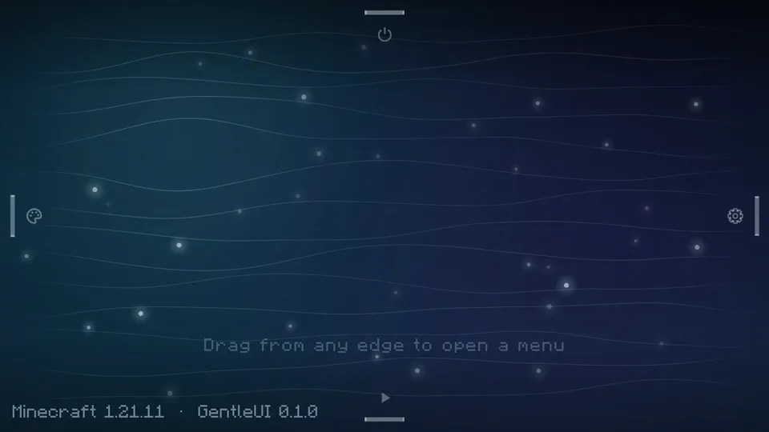

</div>

GentleUI 会替换标题画面、暂停菜单和世界加载画面，再把设置、存档列表、多人游戏、资源包这些原版界面统一成同一种风格。游戏里的 HUD、物品栏、箱子之类的界面不会动。

界面上的图形全部是实时绘制的矢量图，不用贴图，也不需要额外的资源包。内置三套主题，可以随时切换。

## 三套主题

### Liquid（流体，默认）

打开游戏，画面上只有一片会跟着鼠标起伏的湖面，角落里是版本号和一行操作提示。

菜单藏在屏幕的四条边上：下边是开始游戏，右边是选项，左边是个性化，上边是系统。从边缘往里拖，会拉出一滴水，松手后它变成一个气泡，子菜单绕着它一圈一圈展开。比如 选项 → 更多 → 聊天设置，就是三层。

<p>
  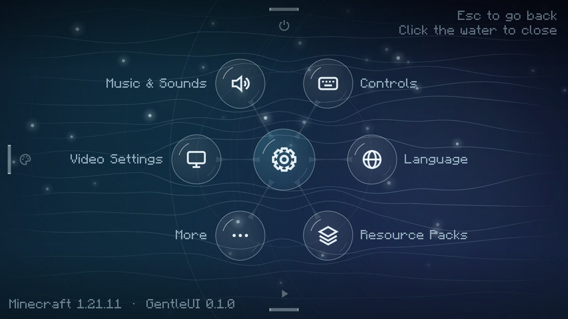
  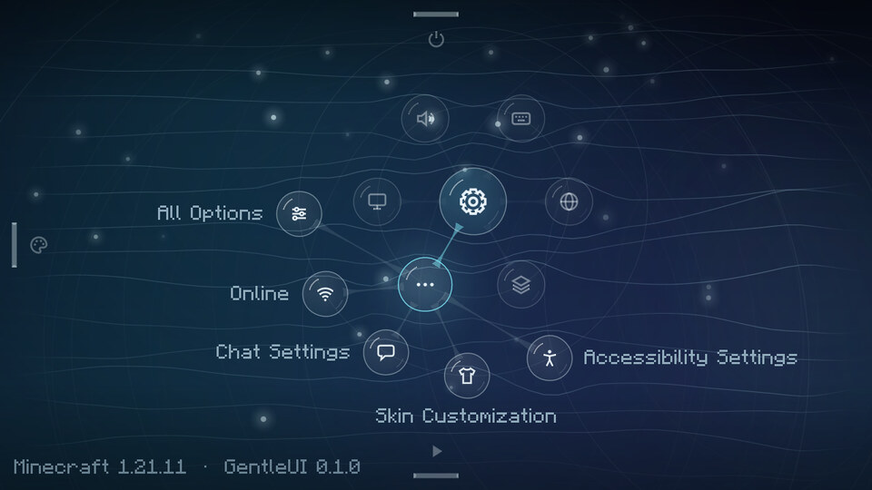
</p>

湖面有四种配色：夜湖、晨雾、深渊、青瓷。

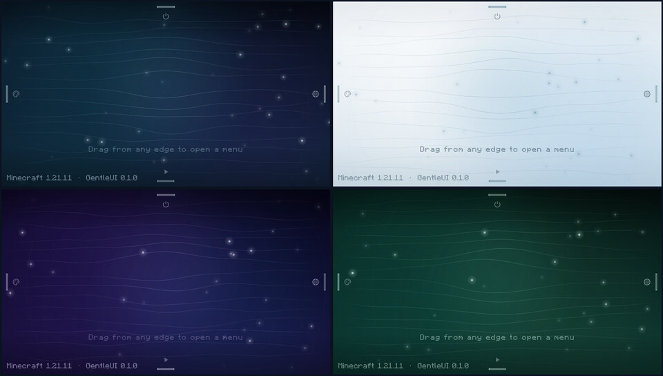

### Material（彩绘）

浅色背景、大圆角按钮，背后飘着几块彩色的几何图形，有点 Google 产品页的味道。右边那张卡片可以一键回到上次玩的存档。强调色可以换，也有深色模式。


### Glass（玻璃）

缓慢流动的极光渐变上叠着磨砂玻璃面板，底部是一排 Dock 图标，鼠标经过会放大。在游戏里按 Esc，背后的画面会被模糊掉。

<p>
  
  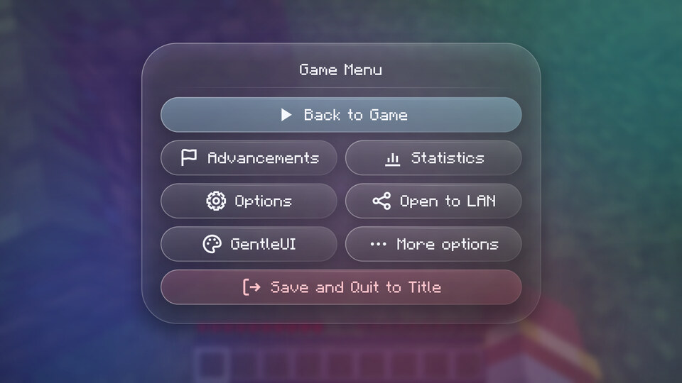
</p>

## 不只是标题画面

打开"统一所有菜单风格"以后，设置、存档列表、创建世界、多人游戏、资源包、按键绑定这些原版界面都会按当前主题重新绘制。

GentleUI 改的是按钮、滑块、输入框、标签页、滚动列表这些控件本身的画法，不是一个界面一个界面去适配，所以大部分用原版控件写的模组界面也会跟着变。浅色主题下，文字会自动改成深色。

<p>
  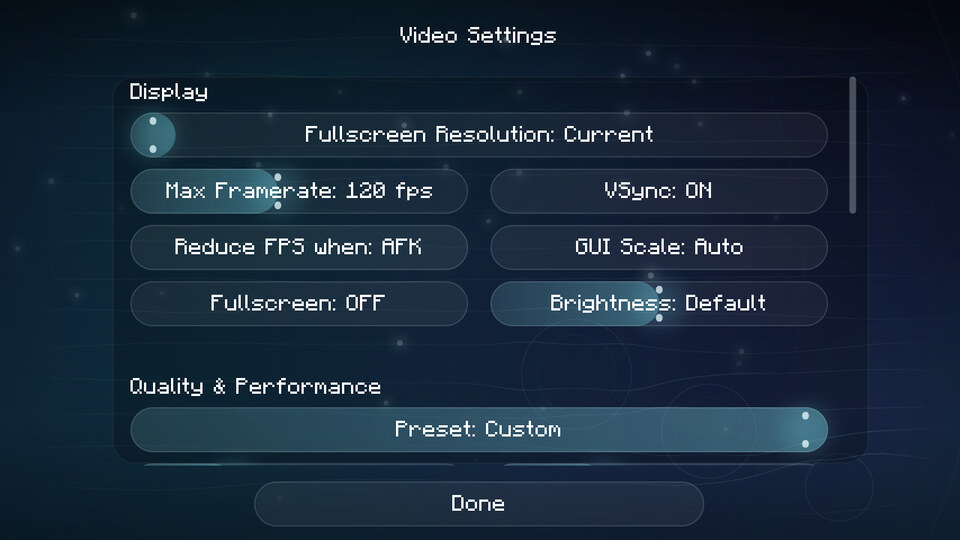
  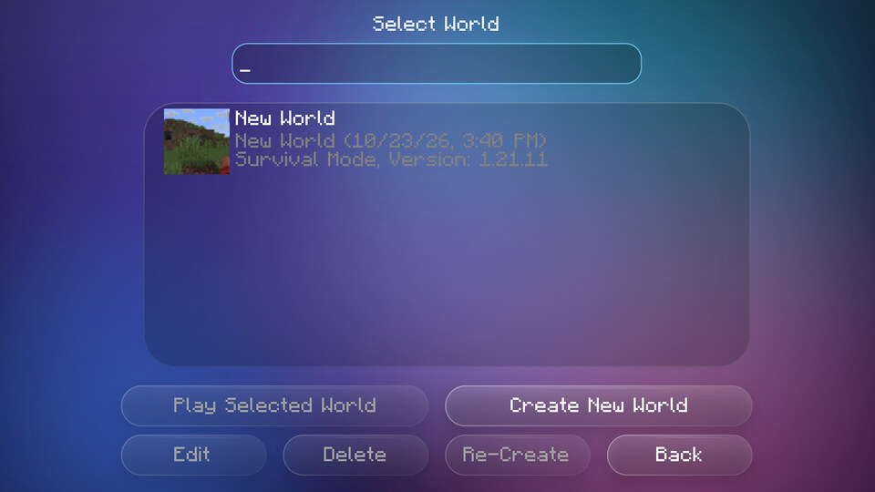
  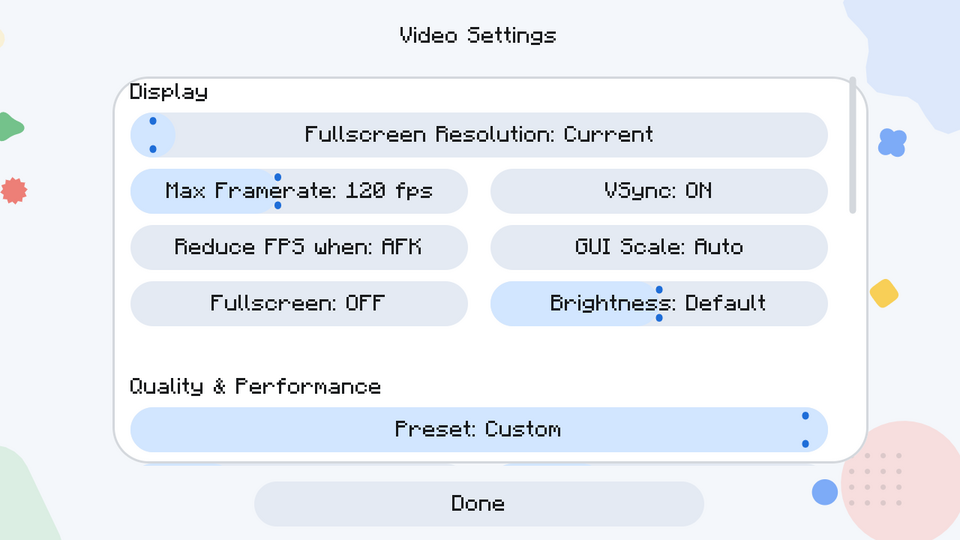
  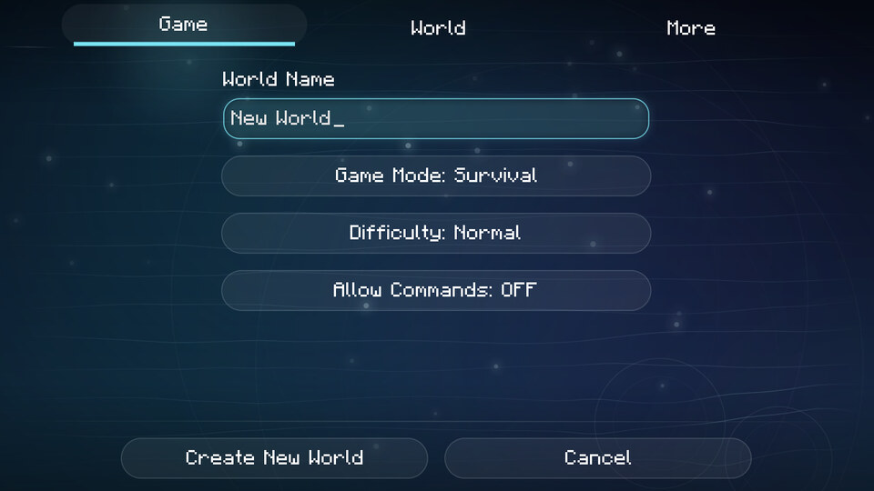
</p>

暂停菜单和加载画面是重新做的。Liquid 主题下加载世界时，水会慢慢灌满中间那个气泡。

<p>
  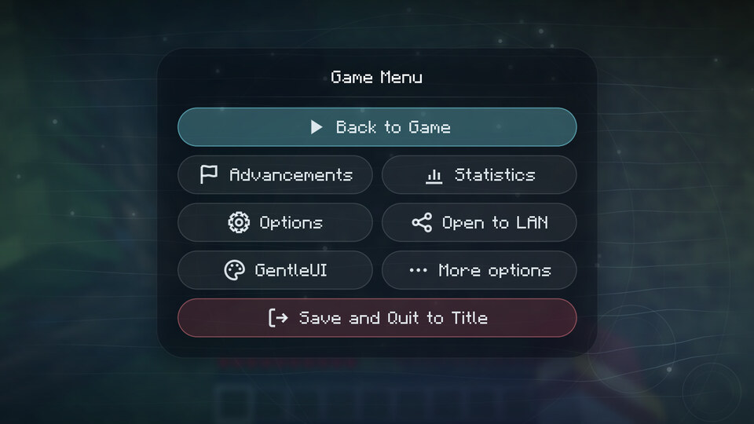
  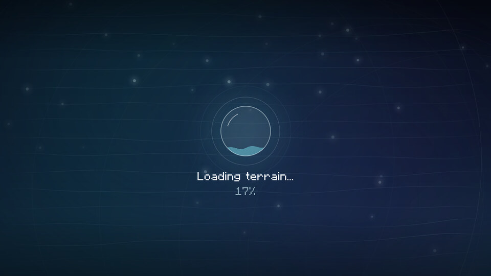
</p>

每个界面都有过渡动画，幅度都不大，不会挡着操作。动画速度可以在设置里调，不喜欢动效的话也可以打开"减弱动态效果"。

## 自定义

设置界面和布局编辑器在 Liquid 左边缘的"个性化"菜单里，Material 和 Glass 则放在底部的图标栏。

设置界面里可以换主题和配色，调动画速度和背景细节，也能单独决定要不要接管暂停菜单、加载画面和其他原版界面。改动会立刻生效，不用重启。

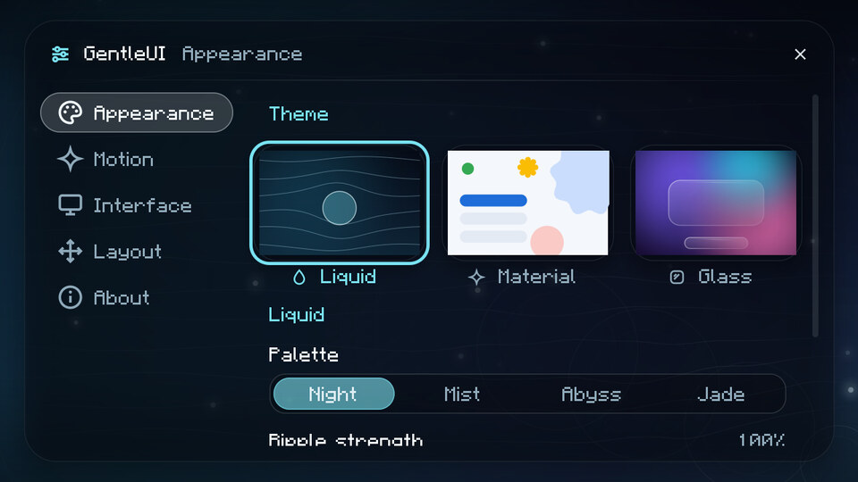

布局编辑器用来摆标题画面。主题自带的元素可以拖动、滚轮缩放、调透明度或者隐藏。你也可以自己加文字、图片、时钟、按钮和形状。按钮能绑定动作，比如一键连某个服务器，或者打开一个网页。图片放进 `config/gentleui/images/` 就能用。每个主题的布局分开保存，随时可以重置。

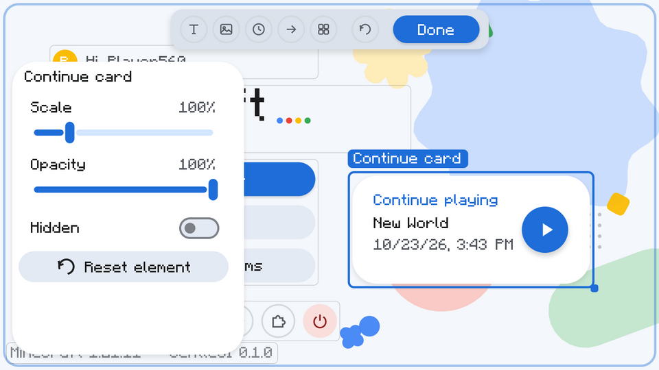

## 安装

| Minecraft | Fabric Loader | Java |
| --- | --- | --- |
| 1.21.11 | 0.19.3 或更新 | 21 或更新 |
| 26.3 | 0.19.5 或更新 | 25 或更新 |

把对应版本的 jar 放进 `.minecraft/mods` 就行。不需要 Fabric API。装了 Mod Menu 的话，可以从模组列表打开 GentleUI 的设置，菜单里的"模组"入口也会可用。

目前还没有发布页，jar 需要自己构建，方法见文末。

## Liquid 怎么操作

- 从任意一条边往里拖，拖过一小段后松手，或者快速往里甩一下，菜单就会出来。直接点边上的小把手也行。
- 点带子项的气泡展开下一圈，再点一次收回去。
- 点空白的水面，整个菜单收起。
- Esc、退格键或者鼠标右键会退回上一层。
- 也可以只用键盘。没打开菜单时，按 ↑、Enter 或空格打开"开始游戏"，按 ↓ ← → 打开另外三条边。打开以后用方向键或 Tab 选，Enter 确认。

"经典菜单"（上边缘里）会临时打开一次原版标题画面，给那些只在原版标题页加按钮的模组留了个入口。

## 配置文件

设置都存在 `config/gentleui/gentleui.json`。大部分选项在设置界面里就能改，需要手动编辑的主要是两件事：改 Liquid 四条边的菜单，以及把不想被换皮的界面排除掉。改完重启游戏生效。缺的字段会用默认值补上；如果整个文件解析不了，GentleUI 会把它备份成 `gentleui.json.broken`，然后用默认配置启动。

比如在上边缘加两个按钮，一个连服务器，一个打开网页：

```json
{
  "liquid": {
    "menus": {
      "top": {
        "id": "system", "label": "gentleui.menu.system", "icon": "power",
        "children": [
          { "id": "hub",  "label": "我的服务器", "icon": "server", "action": "connect:play.example.net" },
          { "id": "wiki", "label": "Wiki",       "icon": "book",   "action": "url:https://minecraft.wiki" },
          { "id": "quit", "label": "menu.quit",  "icon": "power",  "action": "quit" }
        ]
      }
    }
  },
  "skinExclusions": ["com.example.SomeModScreen"]
}
```

`label` 可以写翻译键，也可以直接写文字。有 `children` 的节点会展开下一圈，没有的就执行 `action`。加上 `"hidden": true` 可以隐藏某个节点。

菜单和自定义按钮能用的动作：

| 动作 | 作用 |
| --- | --- |
| `singleplayer` `multiplayer` `realms` | 打开对应界面 |
| `continue` | 进入最近玩的存档 |
| `world:<存档文件夹>` | 进入指定存档 |
| `connect:<地址>` | 连接服务器 |
| `url:<链接>` | 确认后打开网页 |
| `options`，以及 `options.video` `options.sound` `options.controls` `options.language` `options.packs` `options.accessibility` `options.skin` `options.chat` `options.online` | 原版设置的各个页面 |
| `theme:liquid` `theme:material` `theme:glass` | 切换主题 |
| `gentleui.settings` `gentleui.editor` | GentleUI 设置、布局编辑器 |
| `folder:config` `folder:images` | 打开配置或图片文件夹 |
| `mods` | 模组列表（需要 Mod Menu） |
| `credits` `quit` `vanilla_title` | 制作人员、退出游戏、打开一次原版标题画面 |

暂停菜单另外还有 `resume` `advancements` `statistics` `lan` `disconnect` `feedback` `player_reporting` `vanilla_pause`。当前用不了的动作会显示成灰色，比如没有存档时的"继续游戏"。

## 从源码构建

Fabric Loom 1.19 要用 JDK 25 来跑 Gradle。1.21.11 的 jar 按 Java 21 编译，26.3 的按 Java 25 编译。

```bash
export JAVA_HOME=/path/to/jdk-25
./gradlew build                        # 构建两个版本并跑单元测试
./gradlew :fabric-1.21.11:runClient    # 启动 1.21.11 开发客户端
./gradlew :fabric-26.3:runClient       # 启动 26.3 开发客户端
```

构建好的 jar 在 `fabric/<版本>/build/libs/`。

代码分成两层：`core` 里是主题、控件、动画和配置，跟 Minecraft 无关；`fabric/<版本>/` 是很薄的一层适配。1.21.11 移植到 26.3 的时候 `core` 一行都没改。想移植到别的版本，可以看 [docs/ARCHITECTURE.md](docs/ARCHITECTURE.md)。

## 已知问题

- 模组自己用贴图画的控件不会被替换，比如 Mod Menu 的筛选按钮。界面背景和其中的原版控件还是会换。
- 目前只有 Fabric 版。
- 26.3 只在开发环境里测过。

遇到问题欢迎提 [Issue](https://github.com/AlexWhiteHK/GentleUI/issues)，最好附上截图和用到的其他模组。

## 许可

MIT，见 [LICENSE](LICENSE)。作者 AlexWhite。
