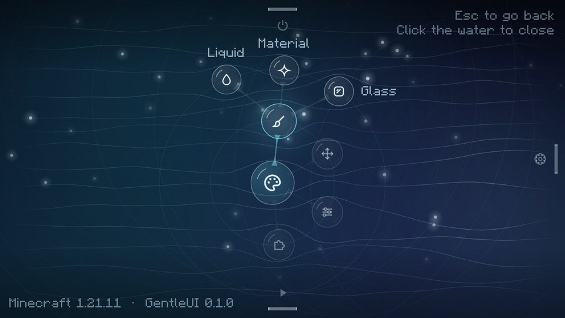
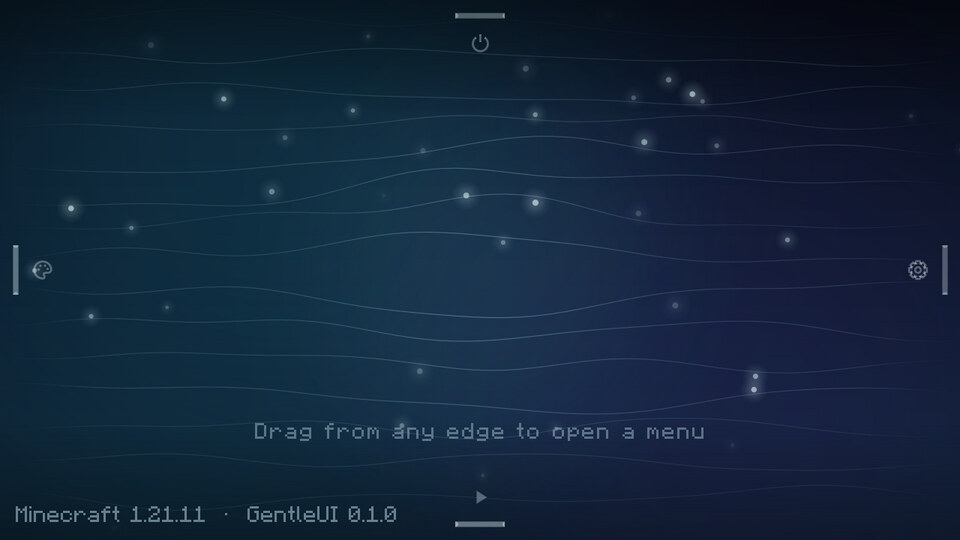
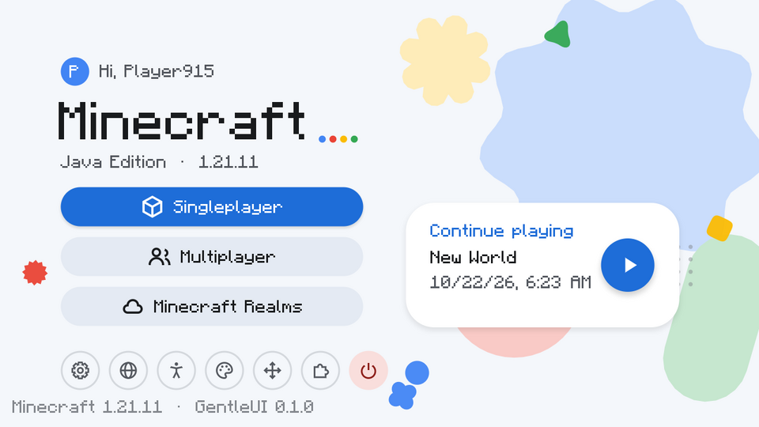
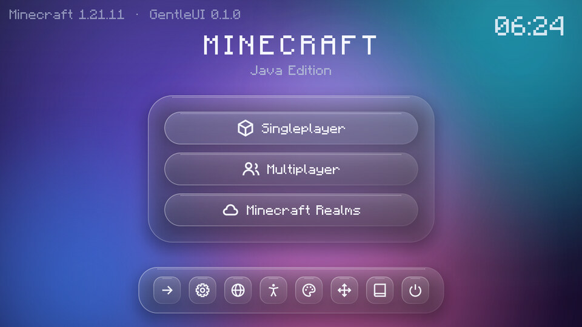
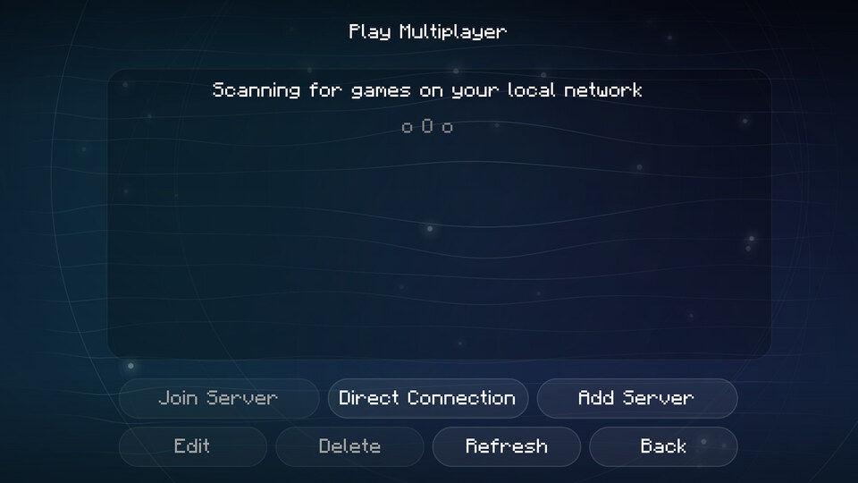
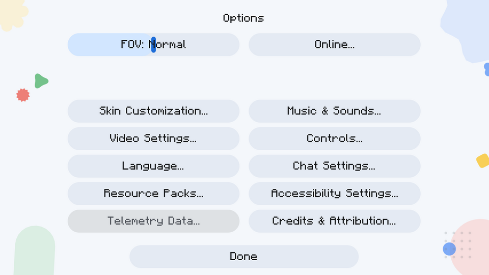
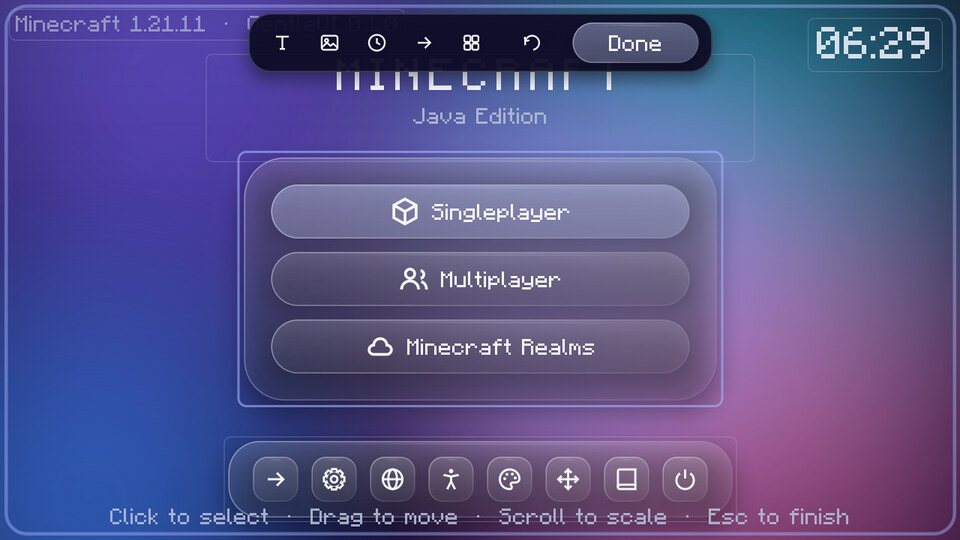

# GentleUI

GentleUI 是一个 Fabric 客户端模组，用矢量绘制、带动效的现代界面替换 Minecraft 的标题画面、暂停菜单与加载画面，并把原版及其他模组的所有非游戏内菜单统一为同一套主题风格。游戏内 HUD、物品栏、容器等玩法界面保持原样。



| 版本 | Minecraft | Fabric Loader | Java | 构建产物 |
| --- | --- | --- | --- | --- |
| 主目标 | 1.21.11 | ≥ 0.19.3 | ≥ 21 | `fabric/1.21.11/build/libs/gentleui-fabric-1.21.11-<ver>.jar` |
| 向上兼容验证 | 26.3 | ≥ 0.19.5 | ≥ 25 | `fabric/26.3/build/libs/gentleui-fabric-26.3-<ver>.jar` |

两个版本共用同一份核心代码（`core`），只有一层薄适配器随 Minecraft 版本变化。代码不调用 Fabric API，运行时只需要 Fabric Loader；Mod Menu 为可选，装有时可从模组列表进入设置（1.21.11），并启用菜单中的"模组"入口。

## 三套内置主题

**Liquid（流体，默认）**：以拖拽为核心的交互。空闲时画面只有一片随鼠标起伏的矢量湖面、四边的把手、操作提示与版本号，没有其他文字。从屏幕上、下、左、右任一边缘向内拖出一滴"水"，松手后它脱离岸边成为菜单根气泡，子项以环形逐层展开：`开始游戏 → 单人游戏 / 多人游戏 / Realms / 继续游戏`，`选项 → 视频 / 声音 / 按键 / 语言 / 资源包 / 更多 → …`。湖面会对指针、气泡与点击产生涟漪，可选 `night`、`mist`、`abyss`、`jade` 四种配色。

**Material（彩绘）**：参考 Google 的彩色矢量风格，浅色底配大圆角按钮、漂浮的几何图形（花瓣、波浪圆、星形等），以种子色生成色调体系，支持深色模式。标题页带"继续游戏"卡片，直达最近一次的存档。

**Glass（玻璃）**：动态极光渐变背景上的磨砂半透明面板，Dock 式快捷栏带鼠标放大效果，在游戏内打开时可对游戏画面做模糊。配色 `aurora`、`sunset`、`ocean`、`frost`。

| Liquid 空闲 | Material | Glass |
| --- | --- | --- |
|  |  |  |

所有主题共享同一套动效原则：解析阻尼弹簧驱动位置、缩放与透明度，进出场带错峰延迟，界面切换有过渡；"减弱动态效果"开关与 0.25–3 倍动画速度对全部动效生效。

## 统一的菜单风格

开启"统一所有菜单风格"后，GentleUI 在渲染层拦截原版控件的精灵图、纹理、列表背景与文字绘制，按当前主题重绘按钮、滑块、输入框、标签页、滚动列表与面板。因为拦截点位于绘制调用本身而不是具体界面类，原版的选项、视频设置、按键绑定、语言、资源包、多人游戏、创建世界、链接确认等界面，以及大多数使用原版控件的模组界面，都会自动跟随主题。亮色主题下会自动改写文字颜色并去掉文字阴影以保证可读性。

暂停菜单与世界加载/连接进度画面由 GentleUI 自己的主题化界面接管，各自有独立开关。个别不适配的模组界面可以把其完整类名写入配置的 `skinExclusions` 以保留原样。

| Liquid 风格的多人游戏列表 | Material 风格的选项界面 |
| --- | --- |
|  |  |

## 操作方式（Liquid）

| 操作 | 效果 |
| --- | --- |
| 从边缘向内拖动并越过阈值后松手，或快速甩动 | 拉出该边的菜单 |
| 单击边缘把手 | 直接打开该边的菜单 |
| 单击带子项的气泡 | 展开下一圈；再次单击同一气泡收起这一圈 |
| 单击叶子气泡 | 执行对应动作 |
| 单击空白水面 | 收起整个菜单 |
| `Esc` / `Backspace` / 鼠标右键 | 逐级返回，最外层时关闭菜单 |
| 未打开菜单时 `↑` `Enter` `Space` / `↓` / `←` / `→` | 分别打开下 / 上 / 右 / 左边的菜单 |
| 菜单打开时 `←` `↑` / `→` `↓` `Tab`，`Enter` | 在最外圈中移动焦点，确认 |

默认四边分配：下 = 开始游戏，右 = 选项，左 = 个性化（主题、布局编辑、GentleUI 设置、模组），上 = 系统（退出、制作人员、经典菜单）。"经典菜单"会以原版标题画面打开一次，方便访问只在原版标题页注册按钮的模组。

## 自定义

**设置界面**（任一主题的个性化入口、Mod Menu，或暂停菜单）分为外观、动效、界面、布局、关于五个分区，所有修改即时生效并实时预览，包括切换主题。可调项包括主题与配色、Liquid 涟漪强度与气泡文字、Material 强调色/深色/漂浮图形、Glass 磨砂程度/世界模糊/Dock 放大、动画速度、减弱动效、界面过渡、背景随鼠标反馈、背景细节密度、各类界面接管开关、版本号与界面音效。

**布局编辑器**用于自由摆放标题画面：



- 主题内置元素（问候语、标题、按钮组、图标行、继续游戏卡片、Dock、时钟、版本号、操作提示等，视主题而定）可拖动、滚轮缩放、调整不透明度或隐藏；移动时会吸附到屏幕中心与其他元素。
- 可添加五种自定义元素：文字、图片、时钟、快捷按钮、形状。每个元素有锚点（九宫格）、偏移、缩放、不透明度、旋转、尺寸、圆角、颜色等属性。
- 快捷按钮可绑定任意动作，例如直连服务器或打开网页。
- 图片放入 `config/gentleui/images/`，以 `file:名称.png` 引用。
- 方向键微调位置（`Shift` 为 8 倍步长），`Delete` 删除选中元素，`Esc` 取消选择或完成编辑。
- 布局按主题分别保存，可单独重置。

**Liquid 菜单树**完全由配置决定，可在设置中隐藏某一边或恢复默认，也可以直接编辑 JSON 增删节点、调整层级。

### 配置文件

位置：`config/gentleui/gentleui.json`。手动编辑后重启游戏生效；缺失或损坏的字段会被补齐为默认值。

```jsonc
{
  "theme": "liquid",                 // liquid | material | glass
  "animationSpeed": 1.0,             // 0.25 – 3
  "reduceMotion": false,
  "skinMenus": true,                 // 统一原版/模组菜单风格
  "adaptText": true,                 // 亮色主题文字改色
  "themedPauseMenu": true,
  "themedLoading": true,
  "skinExclusions": ["com.example.SomeModScreen"],
  "liquid": {
    "palette": "night",              // night | mist | abyss | jade
    "rippleStrength": 1.0,           // 0 – 2
    "menus": {
      "top": {
        "id": "system", "label": "gentleui.menu.system", "icon": "power",
        "children": [
          { "id": "hub", "label": "我的服务器", "icon": "people", "action": "connect:play.example.net" },
          { "id": "wiki", "label": "Wiki", "icon": "book", "action": "url:https://minecraft.wiki" }
        ]
      }
    }
  },
  "material": { "accent": "#1A73E8", "dark": false, "shapes": true },
  "glass": { "palette": "aurora", "frost": 0.55, "worldBlur": true, "dockMagnify": true },
  "layouts": { "liquid": { "overrides": {}, "custom": [] } }
}
```

`label` 可以是翻译键或直接文字；节点有 `children` 时为分支，否则执行 `action`；`hidden: true` 隐藏节点。

### 动作 ID

菜单节点与自定义按钮共用以下动作字符串，带参数的形式为 `id:参数`。

| 动作 | 说明 |
| --- | --- |
| `singleplayer` `multiplayer` `realms` | 打开对应界面 |
| `continue` | 进入最近游玩的存档 |
| `world:<存档文件夹>` | 进入指定单人存档 |
| `connect:<地址>` | 连接服务器 |
| `url:<https 链接>` | 经确认后打开网页 |
| `options` `options.video` `options.sound` `options.controls` `options.language` `options.packs` `options.accessibility` `options.skin` `options.chat` `options.online` | 原版选项各页 |
| `theme:<id>` | 切换主题 |
| `gentleui.settings` `gentleui.editor` | GentleUI 设置 / 布局编辑器 |
| `folder:config` `folder:images` | 打开 GentleUI 配置或图片目录 |
| `mods` | 模组列表（需要 Mod Menu） |
| `credits` `quit` `vanilla_title` | 制作人员、退出游戏、以原版标题画面打开一次 |
| `resume` `advancements` `statistics` `lan` `disconnect` `feedback` `player_reporting` `vanilla_pause` | 暂停菜单动作 |

当前环境下不可用的动作（例如未安装 Mod Menu 时的 `mods`、没有存档时的 `continue`）会显示为禁用状态；Liquid 中悬停该气泡会显示原因。

## 构建

Fabric Loom 1.19 需要 Gradle 9.8 与 JDK 25 来运行构建；1.21.11 的产物按 Java 21 编译，26.3 的产物按 Java 25 编译。

```bash
export JAVA_HOME=/path/to/jdk-25
./gradlew build                        # 编译全部模块并运行 core 单元测试
./gradlew :fabric-1.21.11:runClient    # 启动 1.21.11 开发客户端
./gradlew :fabric-26.3:runClient       # 启动 26.3 开发客户端
```

## 仓库结构

```
core/              与 Minecraft 无关的核心：数学、动画、颜色、矢量画布、主题、控件、配置、界面场景，含单元测试与共享资源（语言文件、图标）
fabric/1.21.11/    1.21.11 适配器：画布后端、输入映射、界面桥接、皮肤拦截 mixin
fabric/26.3/       26.3 适配器：同一结构，针对 26.x 的 API 变化
docs/              架构说明、移植清单与截图
```

新版本的适配步骤、渲染方案与拦截点说明见 [docs/ARCHITECTURE.md](docs/ARCHITECTURE.md)。

## 许可

MIT，见 [LICENSE](LICENSE)。
